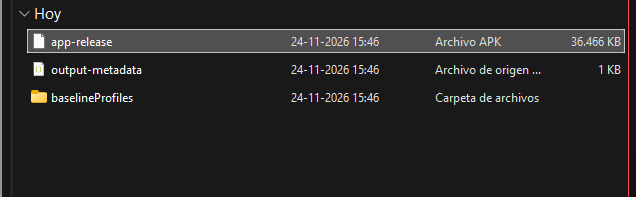
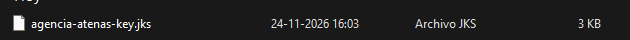

# Agencia Atenas - Gestión de oportunidades

## Integrantes y equipo

- **Integrante 1:** Maxine Moreno
- **Integrante 2:** Dalí Morales
- **Equipo:** 9

## Descripción

Aplicación móvil desarrollada en **Kotlin y Jetpack Compose** para gestionar oportunidades de negocio corporativas.

El proyecto corresponde a la Evaluación 3 de la asignatura **DSY1105 - Desarrollo de Aplicaciones Móviles** (Duoc UC), y continúa el trabajo iniciado en las evaluaciones anteriores de la asignatura.

## Sobre el proyecto

Agencia Atenas necesita organizar sus oportunidades de negocio, como eventos corporativos, ferias y jornadas de beneficios. El propósito del proyecto es entregar una aplicación funcional que permita registrar y dar seguimiento a esas oportunidades: desde su identificación y las gestiones comerciales asociadas, hasta la activación con evidencias y resultados, manteniendo un historial de cada cambio.

## Funcionalidades

| Módulo | Descripción |
| ---------------------- | ---------------------------------------------------------------------------------------------------------------------------------------------------------------------------------------- |
| **Inicio de sesión** | Accede con credenciales de demostración, valida los campos obligatorios y aplica permisos según el perfil (Ejecutivo comercial y Supervisor comercial). |
| **Navegación** | Menú principal con acceso según perfil: el Ejecutivo ve oportunidades, organizaciones y contactos, catálogo de eventos externos, escáner QR y ubicación; el Supervisor consulta y da seguimiento a las oportunidades. |
| **Oportunidades** | Muestra una lista con nombre, tipo, prioridad y estado; incluye datos de ejemplo y permite crear, editar y eliminar oportunidades (según permisos del perfil). |
| **Detalle y edición** | Consulta la información completa de una oportunidad y modifica sus datos. |
| **Formulario** | Crea y edita oportunidades con validación de campos, opciones predefinidas y estado inicial «Evento identificado». |
| **Validaciones** | Muestra mensajes de error junto a los campos e impide guardar información que no cumple los requisitos. |
| **Catálogos** | Administra organizaciones y contactos con formularios validados, para relacionarlos con las oportunidades. |
| **Gestiones comerciales** | Registra contactos, propuestas y seguimientos; actualiza el estado de la oportunidad según la gestión. |
| **Historial de cambios** | Conserva un registro de creación, cambios de estado, prioridad, responsable y gestiones de cada oportunidad. |
| **Activaciones** | Coordina la activación (responsable, espacio, fecha, costo, requisitos), adjunta evidencias en foto o documento y registra el resultado final de la oportunidad. |
| **Escaneo QR** | Usa la cámara para leer códigos con prefijo `MAX:`; los válidos abren la oportunidad asociada y los inválidos se rechazan sin modificar registros. |
| **Ubicación** | Consulta la ubicación del dispositivo bajo demanda, sin seguimiento continuo ni almacenamiento del resultado. |
| **API externa** | Pantalla «API de prueba» (Menú → Catálogo de eventos externos): consulta publicaciones con `GET` y permite crear (`POST`), editar (`PUT`) y eliminar (`DELETE`) registros de prueba de JSONPlaceholder, con validación de campos y mensajes de éxito/error. No se guardan en Room. |
| **Persistencia local** | Mantiene los registros en el dispositivo para que sigan disponibles al cerrar y volver a abrir la aplicación. |
| **Animaciones** | Incluye transiciones entre pantallas, animaciones en la lista y efectos visuales para cambios de estado y mensajes de error. |

## Endpoints utilizados

### API externa (JSONPlaceholder)

Base URL: `https://jsonplaceholder.typicode.com/`

| Método | Endpoint | Descripción |
| ------ | -------- | ----------- |
| `GET` | `https://jsonplaceholder.typicode.com/posts` | Devuelve la lista de publicaciones de prueba al abrir la pantalla «API de prueba» (y al pulsar «Reintentar»). No se almacenan localmente. |
| `POST` | `https://jsonplaceholder.typicode.com/posts` | Crea un registro desde el formulario «Crear Evento (POST)» con id del evento, nombre, fecha, ubicación y organización. |
| `PUT` | `https://jsonplaceholder.typicode.com/posts/{id}` | Actualiza el título y el contenido de una publicación existente de JSONPlaceholder. Las publicaciones creadas con `POST` durante la sesión se editan localmente, porque JSONPlaceholder no las guarda. |
| `DELETE` | `https://jsonplaceholder.typicode.com/posts/{id}` | Elimina una publicación desde «Eliminar» → confirmación «Eliminar (DELETE)». |

Detalles de la integración:

- El cuerpo enviado (`PostRequest`) contiene `userId`, `title`, `body` y los campos opcionales del evento: `eventId`, `eventName`, `date`, `location`, `organization`.
- La respuesta (`PostResponse`) incluye `userId`, `id`, `title`, `body` y los mismos campos de evento cuando la API los devuelve.
- JSONPlaceholder **simula** los cambios: `POST`, `PUT` y `DELETE` responden con éxito, pero no conservan los datos. La pantalla lo indica explícitamente.
- Los datos externos no se guardan en Room, por lo que no interfieren con los registros locales de la aplicación.
- Ante errores HTTP, timeout, sin conexión o JSON inválido, la pantalla muestra un mensaje y permite reintentar.

## APK firmado y llave generada

El APK firmado está disponible para [descarga directa](https://github.com/maxcheryl/Ev3-Desarrollo-Movil/releases/download/v1.0/app-release.apk) en el [GitHub Release v1.0](https://github.com/maxcheryl/Ev3-Desarrollo-Movil/releases/tag/v1.0).

### Evidencia del APK firmado



### Evidencia de la llave generada



> Por seguridad, el archivo `.jks` no se publica en este repositorio público. La llave debe conservarse de forma privada y entregarse por un canal seguro si se solicita.

## Planificación del proyecto

El tablero de planificación y seguimiento del equipo está disponible en [Trello](https://trello.com/b/XOiFMXCR/desarrollo-movil-ev3).

## Credenciales de demostración

| Perfil | Correo | Contraseña |
| ------ | ------ | ---------- |
| Ejecutivo comercial | `dali.morales@at.com` | `dali123` |
| Supervisor comercial | `maxine.moreno@at.com` | `maxine123` |


## Tecnologías utilizadas

- **Lenguaje:** Kotlin 2.2
- **Interfaz:** Jetpack Compose y Material Design 3
- **Arquitectura:** MVVM, ViewModel, StateFlow y Repository
- **Persistencia:** Room 2.8.4 con KSP
- **Navegación:** Navigation Compose
- **API externa:** Retrofit 2.12 con converter Gson
- **Cámara y códigos QR:** CameraX 1.4.2 y ML Kit Barcode Scanning 17.3.0
- **Ubicación:** LocationManager de Android
- **Pruebas unitarias:** Kotest 5.8 (StringSpec) sobre JUnit Platform, MockK y kotlinx-coroutines-test
- **Pruebas de instrumentación:** Compose UI Test y Espresso
- **Entorno:** Android Studio
- **SDK:** compileSdk y targetSdk 37; minSdk 24

## Estructura del proyecto

```text
app/src/main/java/cl/duocuc/evaluacion2/
├── data/
│   ├── historial/      # descripciones del historial de cambios
│   ├── local/          # entidades, DAOs y base de datos Room
│   ├── model/          # modelos y catálogos de la aplicación
│   ├── remote/         # interfaz y configuración de Retrofit
│   ├── repository/     # repositorios (única puerta a los datos)
│   └── session/        # sesión del usuario en memoria
├── location/           # consulta de ubicación del dispositivo
├── navigation/         # rutas y host de navegación
├── qr/                 # escaneo y validación de códigos QR
├── ui/
│   ├── components/     # componentes visuales reutilizables
│   ├── screens/        # pantallas Compose
│   ├── theme/          # tema y colores
│   └── viewmodels/     # ViewModels de cada módulo
└── validation/         # validadores de formularios

app/src/test/java/cl/duocuc/evaluacion2/
├── data/repository/    # pruebas de repositorios (incluye API externa)
└── ...                 # pruebas de ViewModels, validadores y utilidades

app/src/androidTest/java/cl/duocuc/evaluacion2/
└── ...                 # pruebas de instrumentación (pantallas Compose)
```

- `data`: contiene los modelos, el acceso a los datos y su gestión.
- `navigation`: organiza las rutas y la navegación entre pantallas.
- `location` y `qr`: gestionan la ubicación y el escaneo de códigos.
- `ui`: reúne las pantallas, los componentes visuales, el tema y los modelos de vista.
- `validation`: validaciones de los formularios, separadas de la interfaz.
- `app/src/test`: 19 archivos con 105 casos de prueba (Kotest) de ViewModels, repositorios y validadores.
- `app/src/androidTest`: pruebas de instrumentación de las pantallas con Compose UI Test.

## Requisitos para ejecutar la aplicación

- Android Studio (versión actual o compatible).
- JDK 17 o superior.
- SDK de Android con la plataforma 37 y las herramientas de compilación del proyecto.
- Un emulador o dispositivo Android compatible (minSdk 24).
- Conexión a Internet para consultar la API externa.

## Cómo ejecutar la aplicación

1. Clonar o descargar el repositorio.
2. Abrir el proyecto en Android Studio (**File → Open** y seleccionar la carpeta del proyecto).
3. Esperar la sincronización de Gradle (**Sync Now**) y la descarga de dependencias.
4. Seleccionar un emulador o dispositivo conectado (**Device Manager**).
5. Ejecutar el módulo **app** con el botón ▶ *Run*.
6. Iniciar sesión con una de las credenciales de demostración.
7. Para consultar la API externa: ingresar a **Menú → Catálogo de eventos externos** (perfil Ejecutivo; requiere Internet).

### Ejecutar las pruebas unitarias

- Desde Android Studio: clic derecho en la carpeta `app/src/test` → **Run Tests**, o usar *Run → Run with Coverage* para medir la cobertura.
- Desde la terminal: `.\gradlew.bat testDebugUnitTest` (Windows).

### Ejecutar las pruebas de instrumentación

- Desde Android Studio: clic derecho en la carpeta `app/src/androidTest` → **Run Tests** (requiere emulador o dispositivo conectado).
- Desde la terminal: `.\gradlew.bat connectedDebugAndroidTest` (Windows).

### Probar el escáner QR

La aplicación reconoce códigos cuyo contenido comienza con `MAX:`. Las oportunidades de ejemplo utilizan los siguientes códigos:

- `MAX:OP-001`
- `MAX:OP-002`
- `MAX:OP-003`

Pasos: generar un código QR con uno de los valores anteriores → abrir **Escanear código QR** desde el menú → conceder el permiso de cámara → escanear y comprobar que se abra la oportunidad correspondiente. Si el contenido no es válido, la aplicación muestra un mensaje de error sin modificar los registros. En la carpeta `QR-PRUEBA` se incluyen imágenes de ejemplo (`MAX-OP-001.png`, `QR-0067.png`).

Para probar la ubicación en el emulador se puede configurar una posición desde **Extended Controls → Location**.
